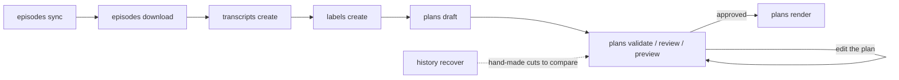

# supercut

supercut turns a run of podcast episodes into one long MP3 with the ads, plugs and other unwanted segments cut out. It downloads episodes from the show's RSS feeds, transcribes them with Whisper, labels every stretch of each episode with one of the show's recurring segments, drafts a cut plan from those labels, and renders the approved plan with ffmpeg: loudness matched across episodes, an interstitial between them, cover art and chapters.

The CLI is built for an agent to drive. Every command prints JSON, every failure carries a stable error code and a next step, and the editorial decisions live in a plan file that a person reviews and approves before anything is rendered.

## How it works



1. `episodes sync` reads the show's feeds into an episode index. `episodes download` fetches the audio, and `episodes adopt` links in audio files you already have.
2. `transcripts create` writes word-timed transcripts with mlx-whisper on Apple silicon or faster-whisper elsewhere. Expect about 5 minutes per hour of audio with mlx-whisper, and about 12 with faster-whisper on a fast CPU.
3. `labels create` sends ~30-second transcript windows to TypeSafe's Jev decision model, which sorts each window into one of the segments configured for the show (intro, hosts, ads, guest). Jev bills per input token; `--dry-run` prints the request count and an estimated token count without sending anything.
4. `plans draft` turns the labels into a cut plan. It cuts every segment marked `cut`, trims each episode's opening to the end of its theme song and its ending at the credits music, puts the interstitial between episodes and lays out chapters. Segments it was unsure about come back in `low_confidence`, and edges it could not place come back in `warnings`.
5. You check the plan. `plans validate` reports errors and edges that land on sounding audio, `plans review` lists every cut with the words heard either side of it, and `plans preview` renders a short reel of every splice. Fixes are edits to the plan's JSON.
6. `plans render` writes the finished MP3.

## Requirements

- Rust 1.88 or newer.
- `ffmpeg` and `ffprobe` on `PATH`.
- A Whisper engine: `mlx_whisper` on Apple silicon (`uv tool install mlx-whisper`), or `whisper-ctranslate2` on any platform (`uv tool install whisper-ctranslate2`).
- A TypeSafe API key for `labels create`, either in `TYPESAFE_API_KEY` or printed by the command set in `jev.api_key_command`. The starter config reads it from 1Password with `op read`.

supercut runs on macOS and Linux. It should build on Windows, but nobody has tried. On Linux, OpenSSL is compiled from source, so no system headers are needed.

## Install

```sh
cargo install --path .
```

## Setup

```sh
supercut config init
```

This writes a commented starter config, `supercut.config.jsonc`, and the JSON Schema it follows, `supercut.config.schema.json`, to the platform config folder. Add `--dry-run` to see the paths first.

| Platform | Config file |
| --- | --- |
| macOS | `~/Library/Application Support/supercut/supercut.config.jsonc` |
| Linux | `$XDG_CONFIG_HOME/supercut/supercut.config.jsonc` |
| Windows | `%APPDATA%\supercut\supercut.config.jsonc` |

`--config <path>` or `SUPERCUT_CONFIG` points supercut at a different file. After editing the config, check it:

```sh
supercut config validate
```

It reports problems in the file and where it found each external tool. `supercut config get` prints the config as supercut resolved it, and `supercut config schema` prints the full settings reference.

The top-level settings:

| Key | Purpose |
| --- | --- |
| `library_dir` | Downloaded audio, transcripts, labels, analysis and plans. Defaults to the platform data folder (`~/Library/Application Support/supercut/library` on macOS). |
| `output_dir` | Where rendered supercuts go, one folder per show. Required by `plans render`. |
| `sideload_dir` | Podcast app folder that `plans render --sideload` copies finished files into. |
| `transcription` | Engine (`mlx-whisper` or `faster-whisper`), model and language. |
| `loudness` | Target integrated loudness (default -16 LUFS) and true-peak ceiling (default -1.5 dBTP). |
| `jev` | Endpoint, model, API key command and request concurrency for labeling. |
| `shows` | One entry per show, keyed by the slug every command takes. |

### Shows

| Key | Purpose |
| --- | --- |
| `title` | The show's name. |
| `feeds` | RSS feeds, read in order. An episode in several feeds keeps the first feed's copy. A private feed's token stays in the URL and is never printed. |
| `artwork` | Cover art embedded in rendered supercuts. |
| `interstitial` | Clip played between episodes. |
| `themes` | Recordings of the theme songs that open episodes. Each episode is cut through the end of the one it plays, except the first in a supercut, which is cut to the hosts' first words. |
| `outros` | Recordings of the first notes of the credits music. Each episode is cut from where one starts. |
| `bumpers` | Jingles that close some episodes. An episode ending with one keeps it, and no interstitial follows it. |
| `segments` | The show's recurring segments: what the labeler sorts stretches into and what gets cut. |
| `chapters` | Optional chapter layout. Without it, each labeled segment gets its own chapter. |

To make the theme, outro, bumper and interstitial recordings, find the moment with `episodes inspect --at` and cut it out with `episodes clip`. `episodes analyze` then shows whether each recording is found in every episode it belongs to.

A segment from the starter config:

```jsonc
{
  "label": "ads",
  "title": "Ads",
  "describe": "Read or produced advertising, usually with a jingle around it.",
  "cut": true,
  "cut_start": "after-previous-speech",
  "cut_end": "before-next-speech",
  "after_phrases": ["we'll be right back"],
  "before_phrases": ["welcome back"],
}
```

Only `label` and `describe` reach the classifier, so `describe` should say what the segment sounds like; changing any other field needs no relabeling. `cut_start` and `cut_end` choose which side of a surrounding jingle the cut lands on. `after_phrases` and `before_phrases` are what the hosts say going into and coming out of the segment, and they place the cut's edges more precisely than the labels can.

The `chapters` layout gives each episode one chapter per stretch between its breaks, titled from templates filled with the feed's season and episode numbers and with named groups matched from the episode title. The starter config has a worked example.

### Rules

Each show can have a Markdown file at `rules/<slug>.md` next to the config file, recording editorial taste: how to group episodes into supercuts, what to cut, which bonus episodes belong. `supercut rules get <show>` prints it. supercut never applies the rules itself; they are written for whoever drafts and checks the plan.

## Making a supercut

```sh
supercut episodes sync the-neighborhood-listen
supercut episodes list the-neighborhood-listen --season 10
supercut episodes download the-neighborhood-listen s10e01 s10e02
supercut transcripts create the-neighborhood-listen s10e01 s10e02
supercut labels create the-neighborhood-listen s10e01 s10e02 --dry-run
supercut labels create the-neighborhood-listen s10e01 s10e02
supercut plans draft the-neighborhood-listen s10e01 s10e02 \
  --title "NHL S10 pt 1" --output nhl-s10-pt-1.mp3 --plan nhl-s10-pt-1.json
supercut plans validate nhl-s10-pt-1.json
supercut plans review nhl-s10-pt-1.json --output text
supercut plans preview nhl-s10-pt-1.json
supercut plans render nhl-s10-pt-1.json --dry-run
supercut plans render nhl-s10-pt-1.json
```

Without `--plan`, `plans draft` writes the plan to `<library>/<show>/plans/<output stem>.json`. `--also-cut s10e02=guest` cuts every `guest` segment from that one episode even though the show keeps guests elsewhere; it can be repeated.

When a cut needs a closer look, `transcripts get <show> <id> --from 28:00 --to 31:00 --output text` prints what was said around it, and `episodes inspect <show> <id> --at 29:20` prints word timings, levels and quiet spans for placing an edge.

### Plans

A plan lists episodes in play order and what to cut from each. Times are positions in the episode's own audio file, written `h:mm:ss.sss`.

```json
{
  "show": "the-neighborhood-listen",
  "title": "The Neighborhood Listen: Season 1",
  "output": "the-neighborhood-listen-S01.mp3",
  "episodes": [
    {
      "id": "s01e01",
      "cuts": [
        {
          "start": "0:00.000",
          "end": "0:56.910",
          "reason": "opening, through the theme the-neighborhood-listen ending at 0:56.519"
        },
        {
          "start": "22:10.960",
          "end": "22:57.430",
          "reason": "segment classified (p=0.86)",
          "fade_in": 0.1
        }
      ],
      "chapters": [
        { "start": "0:56.910", "title": "Intro: S01E01 - Parrots, Whistlers and A Carrot-Haired Woman" },
        { "start": "44:23.150", "title": "Outro: S01E01 - Parrots, Whistlers and A Carrot-Haired Woman" }
      ]
    }
  ]
}
```

A cut without `end` runs to the end of the episode. `fade_out` and `fade_in` are seconds of fade on the audio either side of a cut; an edge without one gets 10 ms so splices never click. An episode can also set `"interstitial_after": false` and a `note` for the reviewer. The plan's `interstitial` is `true` (the default, the show's clip), `false` or a path to another clip.

### Rendering

`plans render` makes one ffmpeg pass. Each kept stretch is brought to the target loudness and faded at its edges, the interstitial plays between episodes, a limiter holds the true-peak ceiling, and the result is encoded as MP3 at the first episode's sample rate and the highest bit rate among the episodes. The file is tagged with ID3v2.3: the plan's title, the show's artwork, and every chapter in a single table of contents, because Castro reads only the first table it finds.

The file goes to `<output_dir>/<show>/<output>`, or to `--out`. An existing file is only replaced with `--force`. `--sideload` also copies it into `sideload_dir`.

## Learning from hand-made supercuts

`history recover` takes a supercut edited by hand and works out how it was made. It fingerprints the export and the downloaded episodes with Chromaprint, finds every stretch of each episode the export plays, times each stretch to the sample and measures its fades.

```sh
supercut history recover the-neighborhood-listen ~/supercuts/nhl-S10-pt-1.mp3 --season 10
supercut history get the-neighborhood-listen nhl-S10-pt-1 --output text
supercut plans compare nhl-s10-pt-1.json <library>/the-neighborhood-listen/history/nhl-S10-pt-1.plan.json
```

It writes the recovery and a plan that reproduces the export to the show's `history/` folder. `history get` lists every cut with what was said in it, and `plans compare` shows where a draft disagrees with the hand-made cuts for the episodes both plans share.

## Output and errors

Results go to stdout as JSON, and progress goes to stderr. Several read commands take `--output text` for a readable view. A failure prints `{"error": {"code", "message", "retryable", "hint"}}` on stderr and exits non-zero:

| Code | Exit status | Meaning |
| --- | --- | --- |
| `INVALID_ARGUMENT` | 2 | The command line or an input file is malformed. |
| `NOT_FOUND` | 3 | A named show, episode, plan or file does not exist. |
| `FAILED_PRECONDITION` | 4 | Something must happen first, such as a sync, download or transcription. |
| `CONFLICT` | 4 | The operation would overwrite something; `--force` allows it. |
| `EXTERNAL_TOOL` | 5 | ffmpeg, the Whisper engine or another program failed. |
| `UNAUTHENTICATED` | 6 | Credentials are missing or rejected. |
| `RATE_LIMITED`, `UNAVAILABLE` | 7 | A remote service throttled or failed; retrying may work. |
| `INTERNAL` | 1 | Anything else. |

Two commands describe the rest:

```sh
supercut cli search "cut the ads out of an episode"
supercut schema plans render
```

`cli search` ranks commands for a task in plain words. `schema` prints an operation's arguments, side effects (network, paid API, heavy compute, which files it writes), output shape and an example; with no operation it prints all of them.

## Agent skill

`skills/building-podcast-supercuts/SKILL.md` teaches an agent the workflow: orienting on a show's rules and history, drafting, checking every cut, and stopping for approval before rendering. To install it for Claude Code:

```sh
ln -s "$PWD/skills/building-podcast-supercuts" ~/.claude/skills/
```

## Library layout

```text
<library>/<show>/
  episodes.json          episode index (feed metadata + local audio file name)
  audio/<id>.<ext>       downloaded episodes
  transcripts/<id>.json  word-timed transcripts
  analysis/<id>.json     loudness and format; <id>.envelope holds the level envelope
  labels/<id>.json       Jev segment labels per transcript window
  fingerprints/<id>.fp   Chromaprint fingerprints (history alignment)
  plans/                 cut plans
  previews/              transition reels rendered from plans
  history/               cuts recovered from hand-made supercuts
```

## Development

```sh
cargo test
```

Some tests encode and probe audio, so they need `ffmpeg` and `ffprobe` on `PATH`. Work in progress and known gaps are in [BACKLOG.md](BACKLOG.md).
